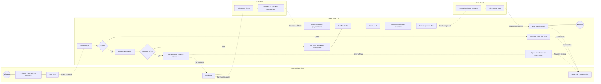
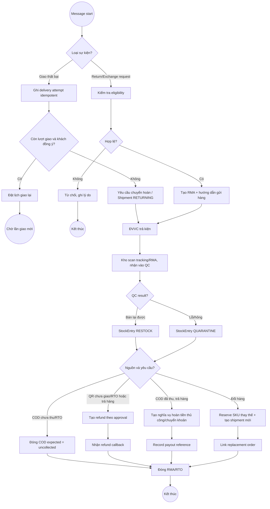
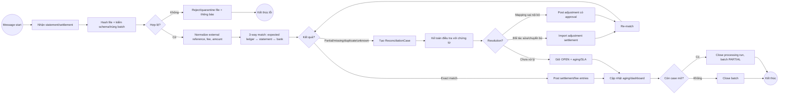

# BPMN 2.0 — ba quy trình Order-to-Cash

> Các sơ đồ dưới đây là blueprint hiển thị trong Markdown. Khi vẽ bằng bpmn.io/Visual Paradigm phải dùng đúng ký pháp BPMN 2.0: pool cho participant độc lập, lane cho vai trò nội bộ, sequence flow chỉ trong một pool và message flow giữa các pool. Không nối sequence flow xuyên pool.

## 1. BPMN-01 — Đặt hàng, thanh toán COD/QR và fulfillment

### 1.1 Đặc tả

| Thuộc tính | Nội dung |
|---|---|
| Trigger | Customer submit order |
| Pool | Khách hàng; SME O2C; PSP; ĐVVC |
| Lane SME | Storefront/Order; Payment; Inventory; Warehouse/Shipping |
| Pre-condition | SKU có dữ liệu tồn và phương thức thanh toán hợp lệ |
| End success | Shipment `HANDED_OVER`, Order `FULFILLING`; QR `PAID` hoặc COD receivable `EXPECTED` |
| End alternate | Order `CANCELLED`; reservation được release; payment intent expired/failed |
| Data | Order, Reservation, Payment, Shipment, OutboxEvent |
| Requirement | FR-01…FR-06, NFR-02, NFR-04 |

### 1.2 Blueprint

### 1.3 Gateway/event bắt buộc khi vẽ BPMN

- XOR `Đủ tồn?` và `Phương thức?`.
- Intermediate message catch `payment.paid`; không coi việc khách mở QR là đã trả tiền.
- Interrupting timer boundary trên subprocess `Chờ thanh toán QR`; khi hết hạn phải expire payment intent và release reservation.
- Service task webhook phải xác thực chữ ký/token và idempotency key trước khi ghi payment ledger.
- Message flow đến ĐVVC; outbox retry nằm trong pool SME, không vẽ sequence flow đi xuyên pool.

## 2. BPMN-02 — Giao thất bại/RTO và đổi-trả sau giao

### 2.1 Đặc tả

| Thuộc tính | Nội dung |
|---|---|
| Trigger A | Carrier gửi `delivery_failed` hoặc `delivery_refused` |
| Trigger B | Customer tạo return/exchange request sau `DELIVERED` |
| Pool | Khách hàng; SME O2C; ĐVVC/PSP |
| Lane SME | Shipping/CSKH; Return; Warehouse/QC; Payment/Inventory |
| Pre-condition | Có Order + Shipment; với return phải còn trong policy giả định |
| End success | Retry scheduled, hoặc RTO/Return được nhận–QC–restock/quarantine và tiền/đơn được điều chỉnh |
| End alternate | Return rejected có lý do; discrepancy/manual case nếu hàng/tiền không khớp |
| Requirement | FR-07…FR-09, NFR-02, NFR-06, NFR-08 |

### 2.2 Blueprint

### 2.3 Quy tắc nghiệp vụ

- `Delivery refusal/RTO` xảy ra trước khi hoàn tất giao; `Customer return/exchange` xảy ra sau `DELIVERED`. Hai khái niệm không dùng chung một trạng thái Order.
- Policy prototype: tối đa 02 delivery attempts; return request trong 07 ngày; các con số là giả định cấu hình.
- Chỉ restock sau khi scan đúng tracking/RMA và QC pass. QC fail vào quarantine, không tăng available-to-promise.
- Refund là một payment transaction mới tham chiếu giao dịch gốc, không sửa/xóa payment entry cũ.
- Message/callback lặp từ carrier/PSP phải bị khử trùng theo external event ID.

## 3. BPMN-03 — Đối soát COD/QR và xử lý chênh lệch

### 3.1 Đặc tả

| Thuộc tính | Nội dung |
|---|---|
| Trigger | Carrier/PSP statement và bank settlement được nhận theo kỳ |
| Pool | Carrier/PSP/Bank; SME O2C |
| Lane SME | Import/Validation; Matching Engine; Accountant; Reporting |
| Pre-condition | Expected ledger đã có order_id, external_ref, amount và payment method |
| End success | Batch closed; các dòng matched hoặc có case có owner/SLA |
| Data | Statement, StatementLine, PaymentEntry, Shipment, Settlement, ReconciliationCase |
| Requirement | FR-10…FR-13, NFR-06, NFR-08 |

### 3.2 Blueprint

### 3.3 Luật matching

1. Khóa ưu tiên: provider + external transaction/tracking reference; không match chỉ bằng số tiền.
2. COD expected = số phải thu khách; carrier statement = COD collected − carrier fees; bank settlement = tiền thực nhận. Phí phải là entry riêng.
3. QR expected/paid/refund lấy từ Payment Ledger; PSP statement và bank settlement là hai nguồn độc lập.
4. Tolerance prototype bằng 0 VND; mọi lệch tiền tạo case. Có thể cấu hình tolerance sau nếu nghiệp vụ phê duyệt.
5. File trùng được nhận biết bằng provider + batch_id và hash; dòng trùng bằng provider + external_ref + entry_type.

## 4. Checklist chuẩn BPMN

- Mỗi process có một start event và các end event rõ nghĩa.
- Gateway chia nhánh có điều kiện gắn trên outgoing sequence flow; nhánh default được đánh dấu.
- Message event dùng cho callback/statement; timer event dùng cho QR expiry, retry và SLA.
- Data object liên kết bằng data association, không dùng sequence flow.
- Pool black-box của PSP/ĐVVC vẫn đủ message flow; không mô tả quy trình nội bộ không biết của đối tác.
- Tên task theo cấu trúc động từ + đối tượng; tên event là điều đã xảy ra.

Tham chiếu: [OMG BPMN 2.0.2](https://www.omg.org/spec/BPMN/2.0.2/PDF).

