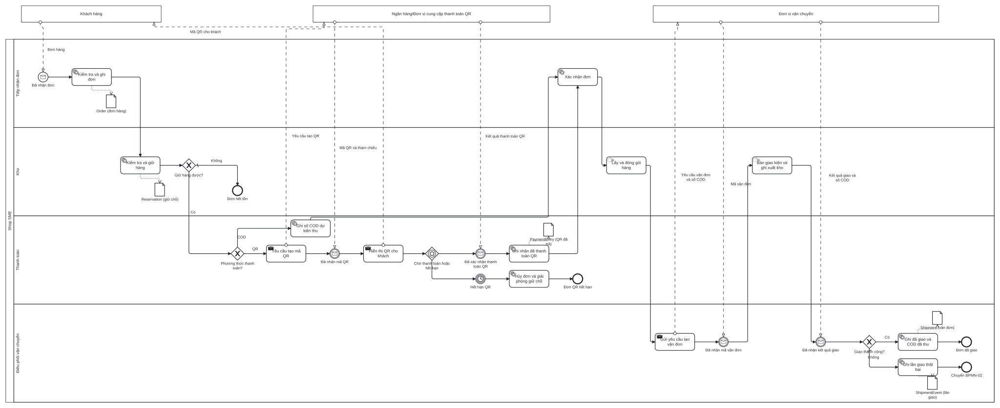
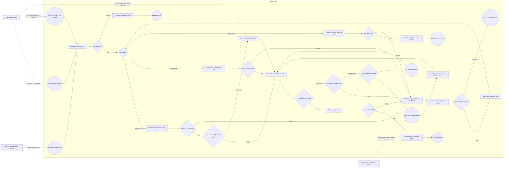

# BPMN 2.0 — ba quy trình Order-to-Cash

## Cách đọc sơ đồ BPMN

BPMN là cách vẽ một quy trình giống như lưu đồ nhưng có quy tắc rõ hơn:

- **Pool** là một tổ chức độc lập, ví dụ Shop, Khách hàng hoặc Đơn vị vận chuyển.
- **Lane** là một vai trò/bộ phận bên trong tổ chức, ví dụ Kho hoặc Kế toán.
- **Task** là một việc cần làm, thường đặt tên bằng động từ như “Kiểm tra tồn”.
- **Event** là việc đã xảy ra, ví dụ “Đã nhận thanh toán”. Hình tròn thường biểu diễn event.
- **Gateway** là điểm rẽ nhánh theo điều kiện, ví dụ “Còn hàng không?”. Hình thoi thường biểu diễn gateway.
- **Sequence flow** là thứ tự công việc bên trong cùng một pool.
- **Message flow** là thông điệp gửi giữa hai pool, ví dụ Ngân hàng/Đơn vị cung cấp thanh toán QR gửi thông báo đã trả tiền cho Shop.

Ba sơ đồ được tách theo ba câu hỏi: xử lý một đơn mới thế nào; xử lý hàng quay về thế nào; và kiểm tra tiền cuối cùng thế nào.

> Mỗi quy trình có tệp `.bpmn` để mở và chỉnh sửa bằng công cụ BPMN 2.0. BPMN-01 có ảnh SVG xuất trực tiếp từ tệp này. BPMN-02 và BPMN-03 có sơ đồ Mermaid để xem nhanh trong Markdown.

Tên bản ghi dùng theo [danh mục Data Object trong ArchiMate](02_archimate_chuan_hoa.md#51-data-object-và-ownership). Khi vẽ BPMN, dùng Data Object để thể hiện thông tin cần đọc hoặc tạo tại một bước. [Phụ lục C](02_archimate_chuan_hoa.md#phụ-lục-c--ý-nghĩa-và-lý-do-cần-từng-data-object) giải thích lý do lưu từng bản ghi.

## 1. BPMN-01 — Luồng chính đặt hàng, thanh toán COD/QR và giao hàng

### 1.1 Sơ đồ BPMN 2.0

[Mở ảnh để phóng to](../diagrams/bpmn_01_order_payment_fulfillment.svg) · [Tệp nguồn BPMN 2.0](../diagrams/bpmn_01_order_payment_fulfillment.bpmn) · [Mã xuất ảnh](../diagrams/export_bpmn_svg.py)

### 1.2 Mô tả ngắn gọn

- **Tác nhân và hệ thống tham gia**

  - **Tác nhân bên ngoài.** Khách hàng gửi đơn, chọn cách thanh toán và nhận hàng. Ngân hàng/Đơn vị cung cấp thanh toán QR tạo mã theo số tiền của đơn và gửi kết quả thanh toán về shop. Đơn vị vận chuyển (ĐVVC) cấp mã vận đơn, nhận kiện và báo kết quả giao. Với COD, nhân viên giao hàng thu tiền thay mặt ĐVVC.
  - **Tác nhân nội bộ.** Bán hàng/CSKH theo dõi đơn và hỗ trợ khách khi cần. Nhân viên kho lấy hàng, đóng gói, bàn giao kiện và xác nhận xuất kho.
  - **Hệ thống.** `Storefront/Backoffice` cung cấp giao diện đặt và theo dõi đơn. `Order` quản lý đơn, `Inventory` giữ hàng và ghi biến động tồn, `Payment` theo dõi số tiền phải thu hoặc đã trả, còn `Fulfillment/Shipping` theo dõi vận đơn. `QR Payment Adapter` và `Carrier Adapter` trao đổi dữ liệu với hai đối tác tương ứng.

- **Điều kiện bắt đầu.** Shop nhận yêu cầu đặt hàng từ khách. Hệ thống kiểm tra thông tin đơn và lượng hàng có thể giữ trước khi xử lý phương thức thanh toán.

- **Điều kiện kết thúc**

  - **Giao thành công.** Shop ghi nhận kết quả giao và số tiền ĐVVC báo đã thu nếu là COD. Số COD được đưa sang BPMN-03 để đối chiếu với tiền thực chuyển vào tài khoản shop theo kỳ tháng. Hóa đơn phí vận chuyển được kiểm tra và thanh toán riêng.
  - **Kết thúc trước khi giao.** Shop dừng xử lý nếu không giữ đủ hàng, hoặc hủy đơn và giải phóng hàng đã giữ nếu mã QR hết hạn trước khi có xác nhận thanh toán hợp lệ.
  - **Giao thất bại.** Shop ghi nhận kết quả lần giao và chuyển sang BPMN-02 để xử lý giao lại hoặc chuyển hoàn.

- **Các nhánh xử lý trong quy trình**

  - **Kiểm tra khả năng giữ hàng.** Nếu giữ đủ hàng, tiếp tục theo phương thức khách đã chọn. Nếu thiếu hàng, dừng trước bước thanh toán.
  - **Thanh toán COD.** Hệ thống ghi số tiền dự kiến thu và truyền đúng số đó trên yêu cầu tạo vận đơn. Tổng này gồm tiền hàng sau giảm giá và phí vận chuyển thu khách. Chẳng hạn, với đơn tổng 300.000 đồng, nhân viên giao hàng thu đúng 300.000 đồng khi giao thành công.
  - **Thanh toán QR.** Ngân hàng/Đơn vị cung cấp thanh toán QR tạo mã đúng tổng tiền đơn. Với cùng đơn 300.000 đồng, mã QR yêu cầu trả 300.000 đồng và phí xử lý QR được giả định bằng 0. Shop chờ một trong hai sự kiện là nhận được xác nhận thanh toán hợp lệ hoặc hết hạn QR. Nếu thanh toán hợp lệ, shop tiếp tục xử lý đơn và đặt số COD trên vận đơn bằng 0 đồng. Nếu hết hạn trước, hệ thống hủy đơn và giải phóng lượng đã giữ.
  - **Kiểm tra kết quả giao.** Khi ĐVVC báo giao thất bại, shop lưu kết quả lần giao để BPMN-02 xử lý tiếp. Nếu kiện được chuyển hoàn, hàng chỉ được xem xét đưa lại vào tồn có thể bán sau khi kho thực nhận và kiểm tra.

### 1.3 Chi tiết phối hợp tác nhân và hệ thống theo TOGAF và ArchiMate

Mỗi dòng đi theo một giai đoạn trên sơ đồ, từ tác nhân nghiệp vụ đến thành phần xử lý, bản ghi được sử dụng và yêu cầu cần đáp ứng. [Yêu cầu trong TOGAF](01_togaf_chuan_hoa.md) · [Thành phần và dữ liệu trong ArchiMate](02_archimate_chuan_hoa.md)

| Giai đoạn BPMN | Tác nhân nghiệp vụ | Thành phần ứng dụng và dữ liệu | Cơ chế kỹ thuật và yêu cầu đáp ứng |
|---|---|---|---|
| **1. Tiếp nhận và kiểm tra đơn** | Khách hàng gửi đơn qua website. Bán hàng/CSKH theo dõi khi cần. | `Storefront/Backoffice` nhận yêu cầu. Phân hệ `Order` kiểm tra và lưu bản ghi `Order`. | Kiểm tra thông tin đơn như mặt hàng, địa chỉ và tổng tiền. **FR-01**. |
| **2. Kiểm tra và giữ hàng** | Shop xử lý tự động ở làn Kho. | `Inventory` lưu `Reservation` và ghi biến động vào `StockEntry` khi giữ hàng thành công. | Kiểm tra số lượng và giữ hàng trong cùng một giao dịch dữ liệu để hai đơn đồng thời không giữ trùng lượng tồn. **FR-02, ADR-02**. |
| **3. Xử lý theo phương thức COD hoặc QR** | Khách hàng đã chọn cách trả. Ngân hàng/Đơn vị cung cấp thanh toán QR tham gia ở nhánh QR. | `Payment` theo dõi thanh toán. Với COD, ghi `PaymentEntry` loại `expected`. Với QR, `QR Payment Adapter` lấy mã và nhận kết quả. `Payment` ghi `PaymentEntry` loại `paid` sau khi xác minh. Khi QR hết hạn, `Inventory` giải phóng `Reservation` và ghi `StockEntry`. | Dùng đúng tổng tiền đơn. Kiểm tra nguồn gửi, mã tham chiếu và số tiền trước khi xác nhận QR. Thông báo gửi lặp chỉ có hiệu lực một lần. **FR-03, EXT-01, NFR-03, NFR-05**. |
| **4. Xác nhận đơn, đóng gói và tạo vận đơn** | Nhân viên kho lấy và đóng gói hàng. ĐVVC cấp mã vận đơn. | `Order` xác nhận đơn. `Fulfillment/Shipping` dùng `OutboxEvent` lưu yêu cầu tạo `Shipment` cần gửi qua `Carrier Adapter`. | Gửi số COD đúng theo phương thức thanh toán. Khi cần gửi lại, dùng cùng mã tham chiếu và xác minh kết quả theo khả năng của ĐVVC để tránh tạo trùng. **FR-04, NFR-03, NFR-04, ADR-03**. |
| **5. Bàn giao kiện và ghi xuất kho** | Nhân viên kho bàn giao kiện cho ĐVVC. | `Inventory` ghi lần xuất trong `StockEntry`. `Fulfillment/Shipping` theo dõi kiện theo `Shipment`. | Ghi xuất theo thời điểm bàn giao thực tế để truy lại biến động tồn. **FR-04, FR-10**. |
| **6. Nhận và ghi kết quả giao** | ĐVVC gửi kết quả. Bán hàng/CSKH tra cứu để hỗ trợ khách khi cần. | `Carrier Adapter` tiếp nhận thông báo. `InboxEvent` giúp nhận biết thông báo gửi lặp. `Fulfillment/Shipping` cập nhật `Shipment` và ghi `ShipmentEvent`. Nếu ĐVVC báo đã thu COD, `Payment` ghi `PaymentEntry` loại `collected`. | Lưu kết quả, thời điểm, mã tham chiếu và lý do nếu giao thất bại. Chuyển lần giao thất bại sang BPMN-02 và dùng số COD báo đã thu làm đầu vào cho BPMN-03. **FR-05, NFR-03, NFR-05**. |

## 2. BPMN-02 — Giao thất bại/RTO và đổi-trả sau giao

### Giải thích bằng lời

Phần này có hai trường hợp dễ bị nhầm:

- **Chuyển hoàn do giao thất bại (RTO):** khách chưa nhận hàng và shop chưa hoàn tất giao.
- **Khách trả/đổi hàng:** khách đã nhận hàng rồi mới gửi lại.

Cả hai đều làm kiện hàng quay về kho, nhưng ý nghĩa về tiền và trạng thái đơn khác nhau. Hàng về phải được quét mã và kiểm tra chất lượng. Chỉ hàng đạt yêu cầu mới được cộng lại vào số có thể bán.

### 2.1 Đặc tả

| Thuộc tính | Nội dung |
|---|---|
| Trigger A | Carrier gửi `delivery_failed` hoặc `delivery_refused` |
| Trigger B | Customer tạo return/exchange request sau `DELIVERED` |
| Pool | Khách hàng, Shop SME, ĐVVC, Đơn vị cung cấp thanh toán QR |
| Lane SME | Điều phối và Bán hàng/CSKH, Xử lý hàng quay về, Kho, Thanh toán và kế toán |
| Pre-condition | Có Order + Shipment; với return phải còn trong policy giả định |
| End success | Giao lại thành công hoặc hàng quay về đã được tiếp nhận, kiểm tra và xử lý theo quyết định được duyệt. |
| End alternate | Yêu cầu đổi/trả bị từ chối có lý do hoặc hồ sơ được chuyển kế toán xác minh. |
| Data | `Order`, `Shipment`, `ShipmentEvent`, `Return/RMA`, `StockEntry`, `Payment`, `PaymentEntry`, `OutboxEvent`, `InboxEvent`. Khi đổi hàng, ghi thêm `Reservation` và `Shipment` của đơn thay thế. |
| Requirement | FR-05, FR-06, FR-07; REQ-COD-01, REQ-COD-03; EXT-02; NFR-03, NFR-06, NFR-08 |

**Dữ liệu trong luồng.** Hàng chuyển hoàn được tra theo mã vận đơn. Yêu cầu đổi/trả sau giao dùng hồ sơ RMA. Khi nhận kiện, kho cập nhật hồ sơ hàng quay về (`Return/RMA`) và ghi `StockEntry` vào khu chờ kiểm. Sau kiểm hàng, kho ghi thêm dòng nhập lại hoặc cách ly. Nếu hoàn tiền, hệ thống ghi dòng `PaymentEntry` mới tham chiếu giao dịch gốc. Khi BPMN-01 đã ghi sự kiện giao thất bại, bước xử lý ngoại lệ dùng lại `ShipmentEvent` theo mã sự kiện.

### 2.2 Sơ đồ quy trình

[Mở nguồn BPMN 2.0](../diagrams/bpmn_02_failed_delivery_return.bpmn) · [Nguồn Mermaid xem nhanh](../diagrams/bpmn_02_failed_delivery_return.mmd)

```mermaid
flowchart LR
  buyer["Khách hàng"]
  carrier["Đơn vị vận chuyển"]
  qr["Đơn vị cung cấp thanh toán QR"]
  subgraph shop["Shop SME"]
    n_startFail(("Đã nhận lần giao thất bại"))
    n_record["Ghi hoặc tra ShipmentEvent"]
    n_retryOk{"Còn lượt và khách đồng ý?"}
    n_retry["Yêu cầu giao lại"]
    n_retryResult(("Đã nhận kết quả giao lại"))
    n_retryDone{"Giao lại thành công?"}
    n_retrySuccess["Ghi đã giao và COD đã thu nếu có"]
    n_retryEnd(("Giao lại thành công"))
    n_rto["Yêu cầu chuyển hoàn"]
    n_startReturn(("Đã nhận yêu cầu đổi/trả"))
    n_eligibility["Kiểm tra điều kiện đổi/trả"]
    n_eligible{"Yêu cầu hợp lệ?"}
    n_reject["Ghi lý do và báo khách"]
    n_rejectEnd(("Yêu cầu bị từ chối"))
    n_rma["Lập RMA và gửi hướng dẫn"]
    n_receive["Thực nhận và đối chiếu mã kiện"]
    n_qc["Kiểm chất lượng hàng"]
    n_qcOk{"Bán lại được?"}
    n_restock["Ghi nhập lại hàng có thể bán"]
    n_quarantine["Ghi đưa hàng vào khu cách ly"]
    n_decision["Xác định hướng xử lý được duyệt"]
    n_action{"Hướng xử lý?"}
    n_uncoll["Ghi COD chưa thu"]
    n_replacement["Giữ hàng thay thế và lập vận đơn"]
    n_sendRefund["Gửi yêu cầu hoàn QR"]
    n_refundResponse(("Đã nhận kết quả hoàn QR"))
    n_refundOk{"Hoàn tiền thành công?"}
    n_refundRecord["Ghi khoản hoàn QR"]
    n_codRefund["Hoàn COD và ghi chứng từ chi"]
    n_verify["Mở hồ sơ cần xác minh"]
    n_pending(("Đã chuyển kế toán xác minh"))
    n_close["Đóng hồ sơ hàng quay về"]
    n_end(("Đã xử lý hàng quay về"))
    n_startFail --> n_record
    n_record --> n_retryOk
    n_retryOk -->|Có| n_retry
    n_retryOk -->|Không| n_rto
    n_retry --> n_retryResult
    n_retryResult --> n_retryDone
    n_retryDone -->|Không| n_record
    n_retryDone -->|Có| n_retrySuccess
    n_retrySuccess --> n_retryEnd
    n_rto --> n_receive
    n_startReturn --> n_eligibility
    n_eligibility --> n_eligible
    n_eligible -->|Có| n_rma
    n_eligible -->|Không| n_reject
    n_reject --> n_rejectEnd
    n_rma --> n_receive
    n_receive --> n_qc
    n_qc --> n_qcOk
    n_qcOk -->|Có| n_restock
    n_qcOk -->|Không| n_quarantine
    n_restock --> n_decision
    n_quarantine --> n_decision
    n_decision --> n_action
    n_action -->|Chuyển hoàn COD đã xác nhận chưa thu| n_uncoll
    n_action -->|Đổi hàng được duyệt| n_replacement
    n_action -->|Hoàn QR được duyệt| n_sendRefund
    n_action -->|Trả sau giao COD đã thu, được duyệt| n_codRefund
    n_action -->|Cần xác minh| n_verify
    n_sendRefund --> n_refundResponse
    n_refundResponse --> n_refundOk
    n_refundOk -->|Có| n_refundRecord
    n_refundOk -->|Không| n_verify
    n_refundRecord --> n_close
    n_uncoll --> n_close
    n_replacement --> n_close
    n_codRefund --> n_close
    n_verify --> n_pending
    n_close --> n_end
  end
  carrier -.->|Thông báo giao thất bại hoặc bị từ chối| n_startFail
  n_retry -.->|Yêu cầu giao lại| carrier
  carrier -.->|Kết quả giao lại| n_retryResult
  n_rto -.->|Yêu cầu chuyển hoàn| carrier
  buyer -.->|Yêu cầu đổi/trả sau giao| n_startReturn
  n_rma -.->|Hồ sơ RMA và hướng dẫn| buyer
  n_sendRefund -.->|Yêu cầu hoàn tiền| qr
  qr -.->|Kết quả hoàn tiền| n_refundResponse
```

### 2.3 Quy tắc nghiệp vụ

- `Delivery refusal/RTO` xảy ra trước khi hoàn tất giao; `Customer return/exchange` xảy ra sau `DELIVERED`. Hai khái niệm không dùng chung một trạng thái Order.
- Giả định prototype cho phép tối đa hai lần giao và nhận yêu cầu đổi/trả trong bảy ngày. BPMN-02 chờ kết quả giao lại. Nếu vẫn thất bại, shop ghi hoặc tra sự kiện theo mã và kiểm tra số lượt còn lại trước khi quyết định chuyển hoàn.
- Mỗi hồ sơ chọn một hướng xử lý được duyệt. Hướng đổi hàng, hoàn QR, hoàn COD sau giao và xác nhận COD chuyển hoàn chưa thu được xét riêng. Hồ sơ chưa đủ căn cứ hoặc hoàn QR thất bại được chuyển xác minh.
- Chỉ restock sau khi scan đúng tracking/RMA và QC pass. QC fail vào quarantine, không tăng available-to-promise.
- Refund là một payment transaction mới tham chiếu giao dịch gốc, không sửa/xóa payment entry cũ.
- Message/callback lặp từ ĐVVC/Đơn vị QR phải bị khử trùng theo external event ID.
- Đơn COD chuyển hoàn được ghi `UNCOLLECTED` khi xác nhận chưa thu tiền. Nếu ĐVVC báo đã thu hoặc thông tin chưa rõ, chuyển kế toán xác minh và giữ nguyên chứng từ để đối soát.

## 3. BPMN-03 — Đối soát COD/QR và xử lý chênh lệch

### Giải thích bằng lời

Kế toán không nên chỉ tin một file do đối tác gửi. Với COD, cuối tháng shop nhận bảng kê ĐVVC, đối chiếu sơ bộ `expected ↔ collected` và xử lý dòng chưa khớp; sau đó ĐVVC chuyển toàn bộ tiền đã thu. Shop dùng tiền vào ngân hàng làm nguồn thứ ba để kiểm tra và đóng kỳ. Phí dịch vụ vận chuyển là một luồng riêng: ĐVVC xuất hóa đơn tháng, shop kiểm tra theo vận đơn/biểu phí rồi thanh toán riêng, tuyệt đối không khấu trừ hoặc net-off vào COD. Với QR, hệ thống so Payment Ledger, bảng kê Đơn vị QR và tiền vào ngân hàng; giả định phí QR bằng 0.

### 3.1 Đặc tả

| Thuộc tính | Nội dung |
|---|---|
| Trigger | Nhận bảng kê COD cuối tháng, bảng kê giao dịch QR hoặc hóa đơn phí ĐVVC. Mỗi loại dùng một Message Start Event. |
| Pool | ĐVVC; Ngân hàng/Đơn vị cung cấp thanh toán QR; Ngân hàng; SME O2C |
| Lane SME | Tiếp nhận hồ sơ, Đối soát tự động, Kế toán |
| Pre-condition | Expected ledger đã có order_id, external_ref, amount và payment method |
| End success | Đã chốt đối soát sau khi ba nguồn khớp, hoặc đã duyệt và ghi riêng khoản thanh toán hóa đơn phí. |
| End alternate | Hồ sơ lỗi được trả để bổ sung. Hồ sơ thiếu chứng từ quá hạn hoặc có khoản chưa khớp được để mở và giao người phụ trách. |
| Data | `PaymentEntry`, `Shipment`, `Statement` (bảng kê COD hoặc QR), `Remittance` (thông tin khoản đối tác chuyển), sao kê ngân hàng, `CarrierInvoice`, chứng từ shop thanh toán phí, `ReconciliationCase` |
| Requirement | FR-08, FR-09, FR-10, FR-11; REQ-COD-02; EXT-03; NFR-06, NFR-08 |

**Dữ liệu trong luồng.** `Statement` cho biết đối tác báo thu theo từng vận đơn hoặc giao dịch. `Remittance` lưu thông tin khoản đối tác chuyển cho shop. Sao kê ngân hàng xác nhận số thực nhận. Kế toán dùng các nguồn này để kiểm tra các khoản trong `PaymentEntry` và theo dõi khoản lệch bằng `ReconciliationCase`. `CarrierInvoice` và chứng từ shop trả phí thuộc nhánh hóa đơn riêng.

### 3.2 Sơ đồ quy trình

[Mở nguồn BPMN 2.0](../diagrams/bpmn_03_reconciliation.bpmn) · [Nguồn Mermaid xem nhanh](../diagrams/bpmn_03_reconciliation.mmd)

### 3.3 Ghép dữ liệu và xử lý chênh lệch

`Matching` nghĩa là tìm và ghép các dòng nói về cùng một giao dịch. Việc ghép phải ưu tiên mã giao dịch/mã vận đơn; không ghép chỉ vì hai dòng có cùng số tiền, vì nhiều đơn có thể trùng giá trị.

1. Khóa ưu tiên: provider + external transaction/tracking reference; không match chỉ bằng số tiền.
2. COD dự kiến của một đơn bằng tổng tiền đơn, gồm phí giao khách trả. Khi chốt kỳ, đối chiếu các đơn đủ điều kiện thu với bảng kê đã thu của ĐVVC. Đơn chuyển hoàn xác nhận chưa thu được ghi `UNCOLLECTED` và loại khỏi số phải chuyển. Ghép tiền vào tài khoản shop theo mã kỳ hoặc mã chuyển khoản và đối chiếu tổng kỳ với các dòng vận đơn. Hóa đơn phí ĐVVC được xử lý riêng.
3. Hóa đơn phí ĐVVC được kiểm riêng theo shipment/tracking, biểu phí và phụ phí; shop thanh toán bằng một luồng tiền ra riêng. `CustomerShippingCharge` không phải `CarrierShippingExpense`.
4. QR expected/paid/refund lấy từ Payment Ledger; bảng kê Đơn vị QR và tiền vào ngân hàng là hai nguồn độc lập. Giả định phí QR bằng 0.
5. Tolerance prototype bằng 0 VND; mọi lệch tiền tạo case. Có thể cấu hình tolerance sau nếu nghiệp vụ phê duyệt.
6. File trùng được nhận biết bằng provider + batch_id và hash, còn dòng trùng dùng provider + external_ref + entry_type. Khi chạy lại đối soát, dùng bảng kê và chuyển khoản đã ghi nhận. ĐVVC chỉ chuyển phần còn thiếu nếu cần chuyển bù. Xác nhận bảng kê COD dùng mã kỳ để tránh gửi lại yêu cầu chuyển tiền khi đối chiếu lại.
7. Khi chứng từ tiền về chưa có và chưa đến hạn, quy trình chờ sao kê hoặc chờ đến hạn. Khi nhận sao kê, lưu thông tin tham chiếu trước khi kiểm tra lại. Đến hạn mà vẫn thiếu chứng từ thì mở hồ sơ chênh lệch.

## 4. Checklist chuẩn BPMN

- Mỗi Start Event ghi nguyên nhân khởi động rõ ràng. Có thể có nhiều Start Event cho những điểm bắt đầu độc lập. End Event ghi kết quả của từng đường xử lý.
- Exclusive Gateway chọn theo điều kiện đã biết. Các nhánh có điều kiện rõ và đánh dấu nhánh mặc định khi có. Event-Based Gateway chuyển sang sự kiện chờ hoặc Receive Task tương ứng.
- Message event dùng cho callback/statement; timer event dùng cho QR expiry, retry và SLA.
- Data object liên kết bằng data association, không dùng sequence flow.
- Pool black-box của Đơn vị QR/ĐVVC vẫn đủ message flow; không mô tả quy trình nội bộ không biết của đối tác.
- Đặt tên task theo động từ và đối tượng xử lý. Tên event mô tả điều kích hoạt hoặc trạng thái kết thúc.

Tham chiếu: [OMG BPMN 2.0.2](https://www.omg.org/spec/BPMN/2.0.2/PDF).

