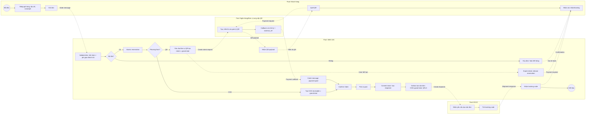
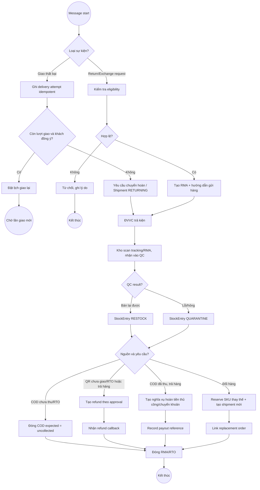
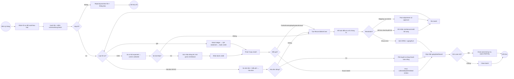

# BPMN 2.0 — ba quy trình Order-to-Cash

## Cách đọc sơ đồ BPMN

BPMN là cách vẽ một quy trình giống như lưu đồ nhưng có quy tắc rõ hơn:

- **Pool** là một tổ chức độc lập, ví dụ Shop, Khách hàng hoặc Đơn vị vận chuyển.
- **Lane** là một vai trò/bộ phận bên trong tổ chức, ví dụ Kho hoặc Kế toán.
- **Task** là một việc cần làm, thường đặt tên bằng động từ như “Kiểm tra tồn”.
- **Event** là việc đã xảy ra, ví dụ “Đã nhận thanh toán”. Hình tròn thường biểu diễn event.
- **Gateway** là điểm rẽ nhánh theo điều kiện, ví dụ “Còn hàng không?”. Hình thoi thường biểu diễn gateway.
- **Sequence flow** là thứ tự công việc bên trong cùng một pool.
- **Message flow** là thông điệp gửi giữa hai pool, ví dụ Ngân hàng/Đơn vị cung cấp thanh toán QR gửi thông báo đã trả tiền cho Shop.

Ba sơ đồ được tách theo ba câu hỏi: xử lý một đơn mới thế nào; xử lý hàng quay về thế nào; và kiểm tra tiền cuối cùng thế nào.

> Các sơ đồ dưới đây là blueprint hiển thị trong Markdown. Khi vẽ bằng bpmn.io/Visual Paradigm phải dùng đúng ký pháp BPMN 2.0: pool cho participant độc lập, lane cho vai trò nội bộ, sequence flow chỉ trong một pool và message flow giữa các pool. Không nối sequence flow xuyên pool.

## 1. BPMN-01 — Đặt hàng, thanh toán COD/QR và fulfillment

### Giải thích bằng lời

Khách gửi đơn. Shop tính `tổng tiền khách trả = tiền hàng sau giảm giá + phí vận chuyển thu khách`, rồi hỏi phân hệ Kho xem còn hàng không. Nếu hết hàng, đơn dừng. Nếu còn hàng, Kho tạm giữ số lượng cần mua. Với COD, hệ thống tạo khoản phải thu đúng bằng tổng đơn và gửi chính số đó cho ĐVVC. Với QR, Ngân hàng/Đơn vị cung cấp thanh toán QR tạo và quản lý Payment Intent đúng bằng tổng đơn; hệ thống chỉ xác nhận sau thông báo thanh toán hợp lệ. Khi tạo vận đơn QR, COD amount bằng 0 nên ĐVVC không thu thêm tiền tại cửa.

### 1.1 Đặc tả

| Thuộc tính | Nội dung |
|---|---|
| Trigger | Customer submit order |
| Pool | Khách hàng; SME O2C; Ngân hàng/Đơn vị cung cấp thanh toán QR; ĐVVC |
| Lane SME | Storefront/Order; Payment; Inventory; Warehouse/Shipping |
| Pre-condition | SKU có dữ liệu tồn và phương thức thanh toán hợp lệ |
| End success | Shipment `HANDED_OVER`, Order `FULFILLING`; QR `PAID` hoặc COD receivable `EXPECTED` |
| End alternate | Order `CANCELLED`; reservation được release; payment intent expired/failed |
| Data | Order (item subtotal, customer shipping charge, grand total), Reservation, Payment/COD Receivable, Shipment, OutboxEvent |
| Requirement | FR-01, FR-02, FR-03, FR-04; EXT-01; NFR-03, NFR-04 |

### 1.2 Blueprint

### 1.3 Gateway/event bắt buộc khi vẽ BPMN

- XOR `Đủ tồn?` và `Phương thức?`.
- Intermediate message catch `payment.paid`; không coi việc khách mở QR là đã trả tiền.
- Interrupting timer boundary trên subprocess `Chờ thanh toán QR`; khi hết hạn phải expire payment intent và release reservation.
- Service task webhook phải xác thực chữ ký/token và idempotency key trước khi ghi payment ledger.
- Message flow đến ĐVVC; outbox retry nằm trong pool SME, không vẽ sequence flow đi xuyên pool.
- Với COD, `shipment.cod_amount = order.grand_total`; với QR, `shipment.cod_amount = 0`. Giả định Đơn vị QR không thu phí.

## 2. BPMN-02 — Giao thất bại/RTO và đổi-trả sau giao

### Giải thích bằng lời

Phần này có hai trường hợp dễ bị nhầm:

- **Chuyển hoàn do giao thất bại (RTO):** khách chưa nhận hàng và shop chưa hoàn tất giao.
- **Khách trả/đổi hàng:** khách đã nhận hàng rồi mới gửi lại.

Cả hai đều làm kiện hàng quay về kho, nhưng ý nghĩa về tiền và trạng thái đơn khác nhau. Hàng về phải được quét mã và kiểm tra chất lượng. Chỉ hàng đạt yêu cầu mới được cộng lại vào số có thể bán.

### 2.1 Đặc tả

| Thuộc tính | Nội dung |
|---|---|
| Trigger A | Carrier gửi `delivery_failed` hoặc `delivery_refused` |
| Trigger B | Customer tạo return/exchange request sau `DELIVERED` |
| Pool | Khách hàng; SME O2C; ĐVVC/Ngân hàng hoặc Đơn vị cung cấp thanh toán QR |
| Lane SME | Shipping/CSKH; Return; Warehouse/QC; Payment/Inventory |
| Pre-condition | Có Order + Shipment; với return phải còn trong policy giả định |
| End success | Retry scheduled, hoặc RTO/Return được nhận–QC–restock/quarantine và tiền/đơn được điều chỉnh |
| End alternate | Return rejected có lý do; discrepancy/manual case nếu hàng/tiền không khớp |
| Requirement | FR-05, FR-06, FR-07; REQ-COD-01, REQ-COD-03; EXT-02; NFR-03, NFR-06, NFR-08 |

### 2.2 Blueprint

### 2.3 Quy tắc nghiệp vụ

- `Delivery refusal/RTO` xảy ra trước khi hoàn tất giao; `Customer return/exchange` xảy ra sau `DELIVERED`. Hai khái niệm không dùng chung một trạng thái Order.
- Policy prototype: tối đa 02 delivery attempts; return request trong 07 ngày; các con số là giả định cấu hình.
- Chỉ restock sau khi scan đúng tracking/RMA và QC pass. QC fail vào quarantine, không tăng available-to-promise.
- Refund là một payment transaction mới tham chiếu giao dịch gốc, không sửa/xóa payment entry cũ.
- Message/callback lặp từ ĐVVC/Đơn vị QR phải bị khử trùng theo external event ID.

## 3. BPMN-03 — Đối soát COD/QR và xử lý chênh lệch

### Giải thích bằng lời

Kế toán không nên chỉ tin một file do đối tác gửi. Với COD, cuối tháng shop nhận bảng kê ĐVVC, đối chiếu sơ bộ `expected ↔ collected` và xử lý dòng chưa khớp; sau đó ĐVVC chuyển toàn bộ tiền đã thu. Shop dùng tiền vào ngân hàng làm nguồn thứ ba để kiểm tra và đóng kỳ. Phí dịch vụ vận chuyển là một luồng riêng: ĐVVC xuất hóa đơn tháng, shop kiểm tra theo vận đơn/biểu phí rồi thanh toán riêng, tuyệt đối không khấu trừ hoặc net-off vào COD. Với QR, hệ thống so Payment Ledger, bảng kê Đơn vị QR và tiền vào ngân hàng; giả định phí QR bằng 0.

### 3.1 Đặc tả

| Thuộc tính | Nội dung |
|---|---|
| Trigger | Cuối kỳ tháng nhận COD statement/remittance, QR statement/bank credit hoặc carrier service invoice |
| Pool | ĐVVC; Ngân hàng/Đơn vị cung cấp thanh toán QR; Ngân hàng; SME O2C |
| Lane SME | Import/Validation; Matching Engine; Accountant; Reporting |
| Pre-condition | Expected ledger đã có order_id, external_ref, amount và payment method |
| End success | Batch closed; các dòng matched hoặc có case có owner/SLA |
| Data | CODStatement, CODRemittance, QRStatement, PaymentEntry, Shipment, CarrierInvoice, ShopPayment, ReconciliationCase |
| Requirement | FR-08, FR-09, FR-10, FR-11; REQ-COD-02; EXT-03; NFR-06, NFR-08 |

### 3.2 Blueprint

### 3.3 Luật matching

`Matching` nghĩa là tìm và ghép các dòng nói về cùng một giao dịch. Việc ghép phải ưu tiên mã giao dịch/mã vận đơn; không ghép chỉ vì hai dòng có cùng số tiền, vì nhiều đơn có thể trùng giá trị.

1. Khóa ưu tiên: provider + external transaction/tracking reference; không match chỉ bằng số tiền.
2. COD expected = tổng tiền đơn gồm phí vận chuyển thu khách; carrier statement = đúng số COD ĐVVC đã thu. Sau đối chiếu sơ bộ, bank remittance phải bằng toàn bộ COD phải chuyển; final match đủ ba nguồn mới đóng kỳ. Không trừ carrier fee trong ba số này.
3. Hóa đơn phí ĐVVC được kiểm riêng theo shipment/tracking, biểu phí và phụ phí; shop thanh toán bằng một luồng tiền ra riêng. `CustomerShippingCharge` không phải `CarrierShippingExpense`.
4. QR expected/paid/refund lấy từ Payment Ledger; bảng kê Đơn vị QR và tiền vào ngân hàng là hai nguồn độc lập. Giả định phí QR bằng 0.
5. Tolerance prototype bằng 0 VND; mọi lệch tiền tạo case. Có thể cấu hình tolerance sau nếu nghiệp vụ phê duyệt.
6. File trùng được nhận biết bằng provider + batch_id và hash; dòng trùng bằng provider + external_ref + entry_type.

## 4. Checklist chuẩn BPMN

- Mỗi process có một start event và các end event rõ nghĩa.
- Gateway chia nhánh có điều kiện gắn trên outgoing sequence flow; nhánh default được đánh dấu.
- Message event dùng cho callback/statement; timer event dùng cho QR expiry, retry và SLA.
- Data object liên kết bằng data association, không dùng sequence flow.
- Pool black-box của Đơn vị QR/ĐVVC vẫn đủ message flow; không mô tả quy trình nội bộ không biết của đối tác.
- Tên task theo cấu trúc động từ + đối tượng; tên event là điều đã xảy ra.

Tham chiếu: [OMG BPMN 2.0.2](https://www.omg.org/spec/BPMN/2.0.2/PDF).

